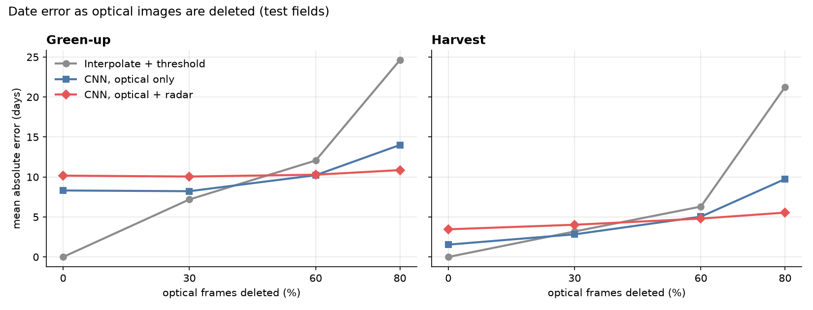
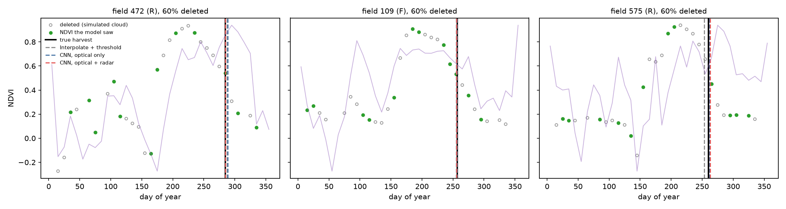
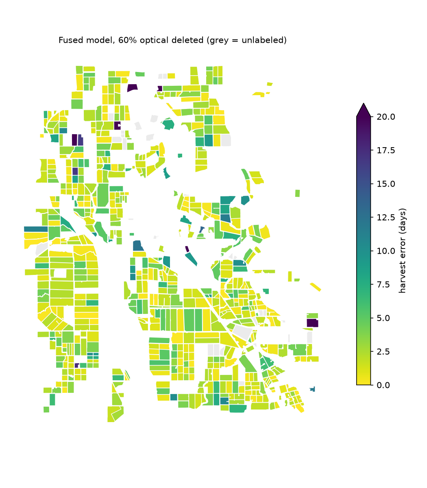

# Field Watch

Detecting when California fields are planted and harvested from satellite imagery,
and measuring how much radar helps when clouds hide the optical images.


**Headline:** with 80% of optical images missing, adding Sentinel-1 radar cut
harvest-date error from 9.7 to 5.5 days (−43%) compared with the same model on
optical data alone, and from 21.3 days for a standard interpolation approach.
With complete optical data, radar did not help. The crossover is around 60% missing.

## Why

In my undergraduate research (Ecological Forecasting Lab, Boston University) I model
planting and harvest dates for California fields. Optical satellites (Sentinel-2)
show crop growth clearly, but clouds and haze leave gaps, often right when timing
matters. Radar (Sentinel-1) sees through clouds but measures something different
(surface structure and water, not greenness). This project asks: **when most optical
images are missing, how much of the timing can radar recover?**

## Approach

1. **Fields:** 704 annual-crop fields (rice, truck, field and grain crops) from the
   California DWR 2024 provisional crop map, Sacramento Valley near Colusa.
   Orchards, vineyards and pasture are excluded (no clear plant-to-harvest cycle).
2. **Signals:** Sentinel-2 NDVI and Sentinel-1 VV/VH backscatter for 2024, streamed
   from Microsoft Planetary Computer, averaged per field and binned to 10-day steps.
3. **Labels:** green-up and harvest dates from each field's clean NDVI curve:
   the halfway point of the seasonal rise and of the fall.
4. **Simulated clouds:** delete 0, 30, 60 or 80% of each field's optical frames on
   purpose, then compare three methods at recovering the dates:
   - **Baseline:** interpolate across gaps, then apply the same halfway rule (no ML, no radar)
   - **CNN, optical only:** a small dilated 1D CNN on NDVI plus a missing-data mask
   - **CNN, optical + radar:** the same network with VV, VH and VH−VV added

   All three methods see identical deleted frames. Fields are split 70/15/15 into
   train, validation and test; every number below is on the test fields.

## Results

Mean absolute error in days, test fields.



**Harvest**

| Optical frames deleted | Baseline | CNN, optical only | CNN, optical + radar |
|---|---|---|---|
| 0%  | 0.0* | **1.5** | 3.5 |
| 30% | 3.2 | **2.8** | 4.0 |
| 60% | 6.3 | 5.0 | **4.8** |
| 80% | 21.3 | 9.7 | **5.5** |

**Green-up (planting)**

| Optical frames deleted | Baseline | CNN, optical only | CNN, optical + radar |
|---|---|---|---|
| 0%  | 0.0* | **8.3** | 10.2 |
| 30% | **7.2** | 8.2 | 10.1 |
| 60% | 12.1 | **10.2** | 10.3 |
| 80% | 24.6 | 14.0 | **10.9** |

\* The baseline uses the same rule that created the labels, so at 0% it matches them
exactly by construction. That row is a sanity check, not a result.

**What this shows:**

- **Radar matters most when optical data is scarcest.** As frames are deleted, the
  fused model's harvest error barely moves (3.5 → 5.5 days), while the optical-only
  model's error grows more than sixfold (1.5 → 9.7) and the baseline's falls apart (→ 21.3).
- **With good optical coverage, radar costs a little accuracy.** It adds noisy inputs
  the model doesn't need, so optical-only wins at 0–30% deleted. In practice, that
  argues for leaning on radar only when optical coverage is poor.
- **Green-up is harder than harvest for both models.** Error stays around 8–10 days
  even with no frames deleted. Harvest is a sharp drop in NDVI; green-up is a gradual
  rise, so its halfway point shifts more with noise, and 10-day bins blur it further.
  Radar only helps green-up at 80% deleted.





*Error map shows all labeled fields (fused model, 60% deleted); reported error
numbers use test fields only.*

## Limitations

- **Labels are derived from optical NDVI**, not field-recorded planting or harvest
  dates. This measures how well each method recovers optical-derived dates under
  gaps, not true agronomic dates.
- **One region, one year, mostly rice.** Results may not transfer to other crops,
  regions or years.
- **Simulated clouds are random.** Real clouds cluster in time (whole weeks of
  winter fog), which is likely harder than random gaps.
- **Radar revisits every ~12 days**, and some 10-day bins have no radar pass.
- **The field map is provisional** (DWR 2024).

## Next steps

- Break error down by crop class to see where green-up fails.
- Validate against real planting and harvest records.
- Simulate clustered, seasonal cloud gaps instead of random ones.
- Use 5-day bins, and gate radar on optical coverage so it only contributes when needed.
- Rewrite the preprocessing (tiling and per-field averaging) in C and benchmark the speedup.

## Run it

```bash
pip install -r requirements.txt
# Download DWR Statewide Crop Mapping (data.cnra.ca.gov) and unzip into data/dwr/
python 01_fields.py          # field boundaries
python 02_extract.py         # imagery; resumable, ~1 hour
python 03_labels.py          # labels + baseline
python 04_train.py           # models + experiment
python 05_figures.py         # figures
streamlit run app.py         # interactive map
```

`00_synthetic.py` generates fake data in the same format, to test the pipeline
without downloading anything.

## Data

- Sentinel-2 L2A and Sentinel-1 RTC via [Microsoft Planetary Computer](https://planetarycomputer.microsoft.com)
- Field boundaries: California Department of Water Resources, Statewide Crop Mapping 2024 (provisional)
